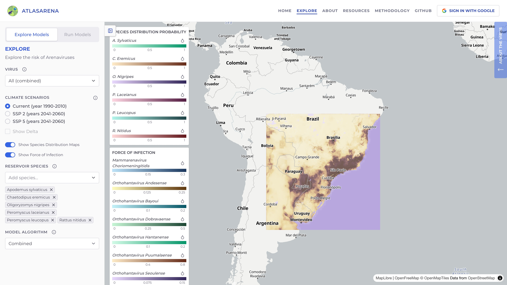

# atlasarena

AtlasArena is a web platform created by UC Davis to showcase modeling of rodent-borne arenaviruses and hantaviruses. These viruses cause human diseases of public health interest around the world, and are spread primarily by rodent reservoir species. AtlasArena uses data on rodent presence and environmental factors to map where reservoir species are likely to occur (species distribution models, SDMs) and the force of infection (FOI) for each species and virus pair, under current conditions and under future climate scenarios (SSP2 and SSP5).

The Explore page shows these layers for 78 reservoir species and 29 viruses. Signed-in users can also upload presence points for one species and run the models on their own data.

## How it works

- **Site:** a Next.js app exported as static files and served from S3 behind CloudFront.
- **Map layers:** every layer is a Cloud Optimized GeoTIFF (COG) listed in `web_app/src/config/catalog.json`. The browser reads the COGs directly with deck.gl-raster on a MapLibre basemap; there is no tile server and no Mapbox.
- **Default layers:** the SDM and FOI COGs and their catalog entries are generated by `atlasarena-model-infra` (`scripts/build_default_layers.py`). The original Junin, Machupo and Guanarito layers are built with `data_preparation/`.
- **Custom runs:** sign-in and model runs go through the `atlasarena-model-infra` API; finished runs are written to a public bucket that the site reads like any other layer.

## Repository layout

- `web_app/`: the Next.js site. See `web_app/README.md` for development, the catalog, map rendering, content and deployment.
- `data_preparation/`: scripts for the original Junin, Machupo and Guanarito layers. See `data_preparation/README.md` for which data is built where.
- `.github/workflows/deploy.yaml`: production deploy on push to `main` or `deploy`. Staging is deployed by hand with `web_app/deploy-staging.sh`.
