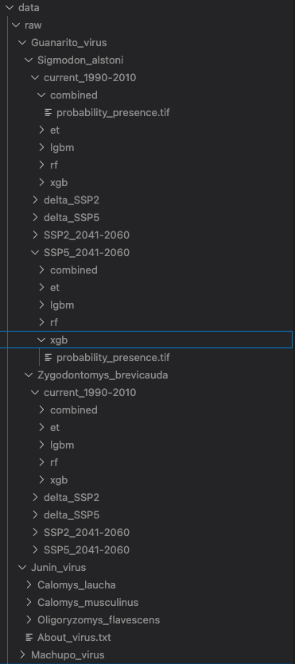

# Data preparation

> **Most of the current map layers are not built here.** The default SDM and FOI
> layers (78 species, 29 viruses, under `cogs/sdm/` and `cogs/foi/`) and their
> entries in `web_app/src/config/catalog.json` are generated by
> `scripts/build_default_layers.py` in the `atlasarena-model-infra` repository.
> Re-running that script on a new data drop regenerates the COGs and the catalog,
> and keeps the catalog's existing `defaults` block.
>
> This folder covers only the original Junin, Machupo and Guanarito layers:
> the per-model (LightGBM, XGBoost, Random Forest, Extra Trees) and delta rasters
> that the catalog still uses.

```text
data_preparation/
├── data/                    # not committed; see below
│   ├── raw/                 # source rasters
│   └── cogs/                # output of make_cogs.py
├── name_equivalence.json    # folder name -> short code
├── requirements.txt         # numpy + GDAL, for make_cogs.py
├── src/make_cogs.py         # raw .tif -> COG
└── legacy_mapbox/           # old Mapbox upload pipeline, unused (see its README)
```

## Source data

Download the original `data` folder and put it in `data/raw`. The folders must
follow the order `virus`, `species`, `time frame`, `model`, then the `.tif` file:

```text
data/raw/[VIRUS]/[SPECIES]/[TIME FRAME]/[MODEL]/[FILENAME].tif
```



`name_equivalence.json` maps each folder or file name to a short code (`short`),
its display name (`spreadsheet`) and, for viruses and species, a colour
(`color`). The short codes make up the output file names.

```json
{
  "Guanarito_virus": { "short": "g", "spreadsheet": "Guanarito virus", "color": "blue" },
  "Junin_virus": { "short": "j", "spreadsheet": "Junin virus", "color": "yellow" },
  ...
}
```

## Create Cloud Optimized GeoTIFFs

The web app reads the rasters directly as COGs. `src/make_cogs.py` converts every
`.tif` under `data/raw` into `data/cogs/<v>_<s>_<t>_<m>_<f>.tif`, named with the
`short` values above so they match the `path` of each layer in
`web_app/src/config/catalog.json`. Values stay float32 in their original units,
and nodata is normalised to NaN.

It needs numpy and the GDAL Python bindings. The bindings must match your system
GDAL, so either `pip install numpy GDAL==$(gdal-config --version)` or use
conda-forge (`conda install -c conda-forge gdal numpy`).

```shell
python3 src/make_cogs.py \
  --raw_folder_path=data/raw \
  --out_folder_path=data/cogs \
  --name_equivalence_path=name_equivalence.json

aws s3 sync data/cogs/ s3://atlasarena-staging-frontend/cogs/ \
  --content-type image/tiff --cache-control "public, max-age=3600"
```

Replacing a file under the same name needs a CloudFront invalidation of `/cogs/*`
to show up within the hour.

Production reads its rasters from this same staging bucket, through the same
CloudFront URL (`cog_base_url` in the catalog). Never overwrite or delete a key
under `cogs/` that a live catalog points at.

To add a new layer, upload the COG and add an entry to `layers` in
`web_app/src/config/catalog.json` (with `virus`, `species`, `time_frame`, `model`
and `variable` keys that exist in the catalog, and a `path` relative to
`cog_base_url`).
