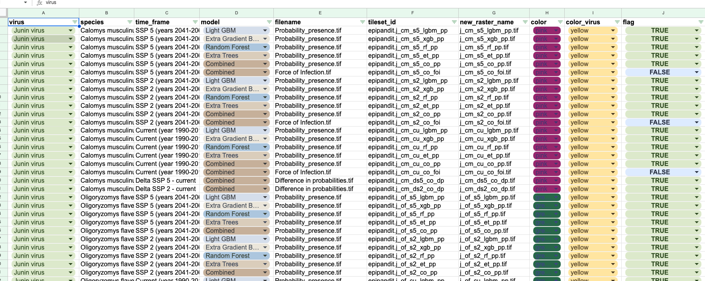

# Legacy: Mapbox tileset pipeline

> **Not used by the current site.** The web app reads Cloud Optimized GeoTIFFs
> directly (see `../src/make_cogs.py` and `../README.md`). This folder is kept
> only as a record of how the first Junin, Machupo and Guanarito layers were
> published, and can be deleted once nobody needs it.

Before the move to COGs, the explore map loaded raster tilesets from Mapbox.
This pipeline:

1. Walked `data/raw/<virus>/<species>/<time frame>/<model>/<file>.tif`.
2. Renamed each raster with the `short` codes in `../name_equivalence.json`
   (for example `j_cm_s5_lgbm_pp.tif`), rescaled it to uint8 and wrote it to
   `data/to_upload/`.
3. Uploaded each file to Mapbox as a tileset, `<MAPBOX_USER>.<new_raster_name>`.
4. Wrote `data/to_upload/data_output_tiff.csv`, which was pasted into a Google
   Sheet that the web app used as its layer catalog. That sheet has since been
   replaced by `web_app/src/config/catalog.json`.

## Files

- `process_tif.sh`: runs `src/pre_process.py` in the Docker image.
- `src/pre_process.py`: standardise, rename and upload rasters (rasterio,
  `mapbox` CLI).
- `Dockerfile`, `docker-compose.yml`: the `geocompas/atlasarena:etl` image
  (Python 3.10, GDAL 3.2).
- `requirements.txt`: Python dependencies for that image.
- `image/spreadsheet.png`: what the catalog spreadsheet looked like.

## Running it (for reference)

Run from `data_preparation/`, so that `data/` and `name_equivalence.json` are
inside the mounted folder:

```shell
docker compose -f legacy_mapbox/docker-compose.yml build
export ACCESS_TOKEN=   # Mapbox token with uploads:write
export MAPBOX_USER=
bash legacy_mapbox/process_tif.sh
```

The CSV it produced looked like this:

```csv
virus,species,time_frame,model,filename,tileset_id,new_raster_name,color,color_virus
Junin virus,Calomys musculinus,SSP 5 (years 2041-2060),Light GBM,Probability_presence.tif,USERR.j_cm_s5_lgbm_pp,j_cm_s5_lgbm_pp.tif,pink,yellow
```


